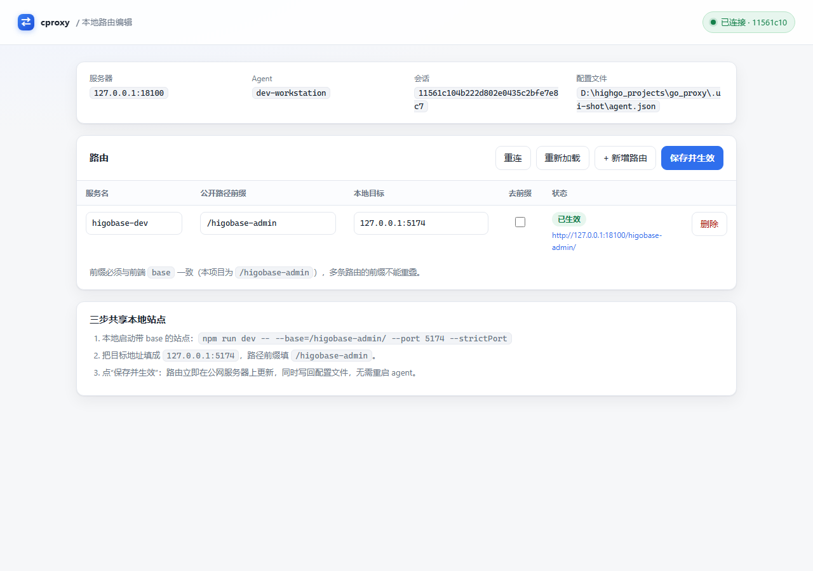

# cproxy

单端口 HTTP 反向隧道。a、b 在各自内网，c 有公网 IP；a 上的 Web 服务通过 c 暴露给 b 访问，**c 只占用一个公网端口**，按 URL 路径前缀区分不同服务。

```
b ──HTTP──▶ c:8080/higobase-admin/... ──┐
                                        ├── 反向代理 ── 隧道(HTTP Upgrade + TLS) ──▶ a-agent ──HTTP──▶ 127.0.0.1:8080
a-agent ──控制通道(同一端口, TLS)────────┘
```

- **c**：`cproxy server`，唯一的公网入口，负责 TLS 接入、路径路由、反向代理和连接池。
- **a**：`cproxy agent`，主动外连 c，把本地 target 注册到指定路径前缀下；a 不需要开放任何入站端口。
- **b**：普通浏览器，只访问 `http://c:8080/higobase-admin/...`，无需安装任何东西。

## 特性

- 单端口：浏览器和隧道共用同一个 TCP 端口，首字节区分明文 HTTP 与 TLS。
- 路径前缀由 agent 配置，server 不需要知道 a 的内网地址。
- 支持 base path 部署（`/higobase-admin` 原样透传），也支持去前缀模式。
- 每个服务独立连接池，HTTP keep-alive 复用隧道连接。
- 支持 SSE、大文件上传下载、流式响应，以及 WebSocket 等协议升级（Vite HMR 可用）。
- agent 断线自动重连（指数退避），服务离线返回 503 而不是 404。
- 隧道自带 TLS + 共享 token + 短期会话 token；证书可自签并用指纹固定。
- **agent 自带本地 Web 界面**（默认 `http://127.0.0.1:7100/`），在线增删改路由，保存即生效并写回配置文件。
- 单个静态二进制，无运行时依赖；提供 systemd 单元和本地管理接口。

## 快速开始（本机验证）

需要 Go 1.22+。

```bash
# 1. 编出二进制（纯 Go，不依赖 make；Windows/macOS/Linux 通用）
go run build.go            # 产物：bin/cproxy.exe、bin/cproxy-linux-amd64、bin/cproxy-linux-arm64
./bin/cproxy gen-token     # Windows 用 .\bin\cproxy.exe gen-token
# 复制输出的 token，后面两处配置都用它

# 2. 起一个本地 Web 应用（任意监听 127.0.0.1:8081 的服务都可以）
```

`server.json`（c 侧）：

```json
{
  "public_listen": "0.0.0.0:8080",
  "admin_listen": "127.0.0.1:7002",
  "token": "REPLACE_WITH_THE_TOKEN",
  "tunnel_tls": { "enabled": true, "auto_generate": true, "public_host": "127.0.0.1" }
}
```

启动 server 后会生成自签证书，用内置命令取出指纹：

```bash
./bin/cproxy fingerprint -c certs/tunnel.crt
# sha256:...
```

`agent.json`（a 侧，`fingerprint` 填上一步的输出）：

```json
{
  "server": "127.0.0.1:8080",
  "agent_id": "a-01",
  "token": "REPLACE_WITH_THE_TOKEN",
  "tunnel_tls": { "fingerprint": "sha256:REPLACE_ME" },
  "services": [
    { "name": "higobase", "path_prefix": "/higobase-admin", "target": "127.0.0.1:8081" }
  ]
}
```

```bash
./bin/cproxy server -f server.json     # 终端 1
./bin/cproxy agent  -f agent.json      # 终端 2
# 浏览器打开 http://127.0.0.1:7100/ 可以在线改路由
curl -v http://127.0.0.1:8080/higobase-admin/
```

server 与 Web 应用不能占用同一个端口：Web 应用监听 8081，agent 的 `target` 指向 `127.0.0.1:8081`。

## 本地管理界面（agent）



agent 启动后会监听 `127.0.0.1:7100`（`ui_listen` 可改，设为 `"off"` 关闭），提供一个小型单页界面：

- 查看当前连接状态、会话 ID、配置文件路径；
- 新增 / 编辑 / 删除路由：服务名、公开路径前缀、本地目标、是否去前缀；
- 保存后**立即生效**：agent 在现有控制连接上重新注册，server 同步更新路由，无需重启；旧的空闲隧道连接会被丢弃，目标地址改动马上生效；
- 同时把最新路由写回 agent 配置文件，重启后保持；
- 校验失败（前缀重叠、非法路径、保留路径、非法目标）会直接返回错误，原路由保持不变；
- 页面每 8 秒自动刷新状态，有未保存修改时不会覆盖你的编辑。

HTTP 接口（`Content-Type: application/json`，写入需要同源）：

| 方法 | 路径 | 说明 |
|---|---|---|
| GET | `/` | 管理页面 |
| GET | `/api/state` | 连接状态 + 路由 + 每个服务的注册结果 |
| PUT | `/api/services` | 覆盖式保存路由，body：`{"services":[{"name":"...","path_prefix":"/...","target":"host:port","strip_prefix":false}]}` |
| POST | `/api/reconnect` | 主动断开并重连服务器 |
| GET | `/healthz` | 探活 |

安全：默认只绑定回环地址；写入要求 `PUT` + JSON，并拒绝跨域 `Origin`，避免被网页 CSRF 调用。如果把 `ui_listen` 改成 `0.0.0.0:7100`，任何能访问该端口的人都能改路由，agent 会打印告警，请自行加防火墙。

## 构建与打包

构建脚本本身是 Go（仓库根目录的 `build.go`），不依赖 make、tar、zip 或 shell，Windows 上直接跑：

| 命令 | 作用 |
|---|---|
| `go run build.go` | 默认构建 windows/amd64、linux/amd64、linux/arm64 到 `bin/` |
| `go run build.go -targets=windows` | 只构建 Windows 版 |
| `go run build.go -targets=linux,linux-arm64` | 只构建 Linux 版 |
| `go run build.go -version 1.2.0` | 指定写入二进制的版本号 |
| `go run build.go release` | 构建并打包出 `dist/*.zip`、`dist/*.tar.gz` |
| `go run build.go test` | 跑全部测试 |
| `go run build.go vet` / `fmt` / `clean` | 对应工具 |
| `go run build.go help` | 查看全部参数 |

- 版本号默认取 `git describe --tags --always --dirty`，没有 git 时用 `0.1.0`；也可用 `-version` 覆盖。
- 交叉编译固定 `CGO_ENABLED=0`，产物是静态二进制，直接拷到目标机即可运行。
- `release` 包内包含 README 和配置样例；Linux 包额外带 systemd 单元与部署手册。

## 场景：把本地开发环境共享给测试人员

本地 `D:\highgo_projects\higobase_platform` 的 Vite 站点（base `/higobase-admin/`）不需要公网 IP，也不用改路由器：

```powershell
# 1. 本地开一个带 base 的共享实例（不影响你平时用的 5173）
cd D:\highgo_projects\higobase_platform\frontend
npm run dev -- --base=/higobase-admin/ --port 5174 --strictPort

# 2. 本地启动 agent（token 与指纹从 c 上取）
.\scripts\dev-share.ps1 -Server 203.0.113.10:8080 `
    -Token 'REPLACE_WITH_TOKEN' `
    -Fingerprint 'sha256:REPLACE_WITH_FINGERPRINT'
```

测试人员访问 `http://203.0.113.10:8080/higobase-admin/`。完整步骤、验证清单与排障见 [docs/deploy-higobase-admin.md](docs/deploy-higobase-admin.md)。

## 部署

### c（公网服务器）

1. 生成 token：`cproxy gen-token > /etc/cproxy/token && chmod 600 /etc/cproxy/token`
2. 写 `/etc/cproxy/server.json`，参考 [`configs/server.example.json`](configs/server.example.json)。
3. 首次启动会自动在 `certs/` 下生成自签证书，日志里会打印 `fingerprint=sha256:...`，把它填到 a 的配置里。
4. 放行 `public_listen` 端口（示例 8080）。**不需要**再开放其他端口。
5. 用 systemd 托管：

```bash
sudo install -m 0755 bin/cproxy /usr/local/bin/cproxy
sudo install -m 0644 deploy/systemd/cproxy-server.service /etc/systemd/system/
sudo systemctl daemon-reload && sudo systemctl enable --now cproxy-server
sudo journalctl -u cproxy-server -f
```

### a（内网服务端）

1. 同样生成 token 文件，内容必须与 c 完全一致（或用 `CPROXY_TOKEN` 环境变量）。
2. 写 `/etc/cproxy/agent.json`，把 `fingerprint` 换成 c 打印的值；`target` 指向本机 Web 应用。
3. 只需出站访问 `c:8080`，不需要任何入站规则。
4. 用 `deploy/systemd/cproxy-agent.service` 托管。

### b（访问方）

浏览器访问 `http://c:8080/higobase-admin/`。

## 路径路由

- agent 通过 `path_prefix` 决定公开路径，必须以 `/` 开头，不能以 `/` 结尾，不能是 `/_cproxy`。
- 前缀按**路径段边界**匹配：`/higobase-adminx` 不会命中 `/higobase-admin`。
- 多个服务的前缀不能重叠（`/a` 与 `/a/b` 冲突），server 会拒绝冲突的注册并只影响该服务。
- `strip_prefix: false`（默认）：原样转发，适合配置了 base path 的应用，例如 `/higobase-admin`。
- `strip_prefix: true`：去掉前缀后转发；访问裸前缀 `/api` 时会 308 跳到 `/api/`，并尽力重写 `Location`。
- 自动注入 `X-Forwarded-Prefix`、`X-Forwarded-Host`、`X-Forwarded-Proto`、`X-Forwarded-For`、`X-Request-ID`。
- `/_cproxy/*` 为保留路径，业务请求一律 404。

### Web 应用的 base path

Web 应用（不是 API）通常会在 HTML 里写死 `/static/...`、`/login` 这类绝对路径。c 不会重写 HTML/JS/CSS，因此：

- **推荐**：应用配置 base path，例如 `/higobase-admin`，agent 用 `strip_prefix: false`。静态资源、跳转、Cookie 都由应用自己生成，最稳定。
- 应用无法配置 base path 时，去前缀模式只对简单接口可靠；SPA 页面可能出现白屏或 404。

## 配置参考

### server

| 字段 | 默认值 | 说明 |
|---|---|---|
| `public_listen` | `0.0.0.0:8080` | 唯一公网监听地址 |
| `admin_listen` | `127.0.0.1:7002` | 管理接口，仅本机；`/healthz`、`/status` |
| `token` / `token_file` | — | agent 共享 token，至少 16 字节；也支持 `CPROXY_TOKEN` |
| `tunnel_tls.enabled` | `true` | 隧道是否走 TLS；关闭后 token 和流量明文传输 |
| `tunnel_tls.cert_file` / `key_file` | `certs/tunnel.{crt,key}` | 隧道证书 |
| `tunnel_tls.auto_generate` | `true` | 证书不存在时自动生成自签证书 |
| `tunnel_tls.public_host` | — | 自签证书里附加的域名或 IP |
| `max_conns_per_service` | `64` | 每个服务同时打开的隧道数据连接上限 |
| `idle_conn_timeout_seconds` | `90` | 隧道空闲连接回收时间 |
| `response_header_timeout_seconds` | `60` | 等待后端响应头的超时 |
| `shutdown_timeout_seconds` | `10` | 优雅退出等待时间 |
| `log_level` / `log_format` | `info` / `text` | 日志级别与格式（`json`） |

### agent

| 字段 | 默认值 | 说明 |
|---|---|---|
| `server` | 必填 | c 的 `host:port`（与 `public_listen` 一致） |
| `agent_id` | 主机名 | 标识这台 a，重连后替换旧会话 |
| `token` / `token_file` | — | 与 c 一致的 token |
| `ui_listen` | `127.0.0.1:7100` | 本地管理界面监听地址；`"off"` 关闭 |
| `tunnel_tls.enabled` | `true` | 是否使用 TLS 连接 c |
| `tunnel_tls.fingerprint` | — | c 证书的 `sha256:<hex>`，自签场景必填；用 `cproxy fingerprint -c tunnel.crt` 得到 |
| `tunnel_tls.ca_file` | — | 或者用 CA 校验（与 fingerprint 二选一） |
| `tunnel_tls.server_name` | `server` 的主机名 | TLS SNI |
| `tunnel_tls.insecure_skip_verify` | `false` | 仅开发调试，跳过证书校验 |
| `services[].name` | 必填 | 服务名，全局唯一 |
| `services[].path_prefix` | 必填 | 公开路径前缀 |
| `services[].target` | 必填 | 本机后端 `host:port` |
| `services[].strip_prefix` | `false` | 是否去掉前缀再转发 |

## 错误码

| 状态 | 含义 |
|---|---|
| `404` | 没有服务注册该路径，或访问了保留路径 `/_cproxy/*` |
| `503` | agent 未连接，或该服务并发连接已满 |
| `502` | 后端连接或转发失败（agent 连不上 target 等） |
| `504` | 等待 agent 数据通道、后端响应头超时 |
| `401` | 隧道 token / 会话 token 无效 |

## 安全

- 隧道默认 TLS（c 自签 + a 指纹固定），token 不落明文；关闭 TLS 会告警。
- token 常量时间比较，认证失败按来源 IP 限速（每分钟 20 次）。
- 数据通道需要 `session_token` + 一次性 `conn_id`，不能单独复用。
- c 会终止 TLS、看到 HTTP 明文，必须是可信节点。
- 没有来源 IP 白名单，任何能访问 `c:8080` 的人都能打开应用登录页；请确保 Web 应用自身有认证。需要时可在 c 前加 nginx 做 IP 限制或 HTTPS 终止。
- 持有 token 的 agent 可以注册任意未被占用的路径前缀；token 等价于 c 的完整权限，请妥善保管。

## 运维

```bash
# 查看在线服务、请求量、错误数
curl -s http://127.0.0.1:7002/status | jq .

# 健康检查
curl -fsS http://127.0.0.1:7002/healthz

# 校验配置
cproxy check -f agent.json

# 本地管理界面
open http://127.0.0.1:7100/
```

日志为结构化文本（`log_format: json` 可切换），访问日志字段包括 `request_id`、`method`、`path`、`status`、`bytes`、`duration_ms`、`remote`、`service`；不记录 `Authorization`、`Cookie` 和请求体。

## 限制

- 只支持 HTTP/1.1 反向代理；不做 HTTP/2、gRPC、UDP。
- 每个 b 连接对应一条独立隧道数据连接，高并发时 c 与 a 的文件描述符约为连接数的 2 倍，需要调大 `ulimit -n`。
- c 是单点，没有高可用；公网带宽是主要瓶颈。
- 不做 HTML/JS/CSS 内容重写，Web 应用应支持 base path。
- 不内置 ACME；需要 HTTPS 时在 c 前置 nginx/caddy 终止 TLS。

## 目录

```
cmd/cproxy/            命令行入口（server/agent/check/fingerprint/gen-token/version）
internal/agent/        控制循环、数据通道、target 转发、重连、本地管理界面
internal/agent/ui/     管理界面静态页面（go:embed）
internal/server/       隧道接入、注册中心、路径路由、反向代理
internal/bridge/       双向复制与半关闭
internal/cert/         自签证书与指纹
internal/config/       配置解析与校验
internal/netutil/      TLS/HTTP 分流、监听器适配
internal/pathutil/     路径前缀规则
internal/protocol/     控制帧编解码
internal/token/        token 加载、生成、比较
configs/               配置样例
deploy/systemd/        systemd 单元
test/e2e/              端到端测试
```